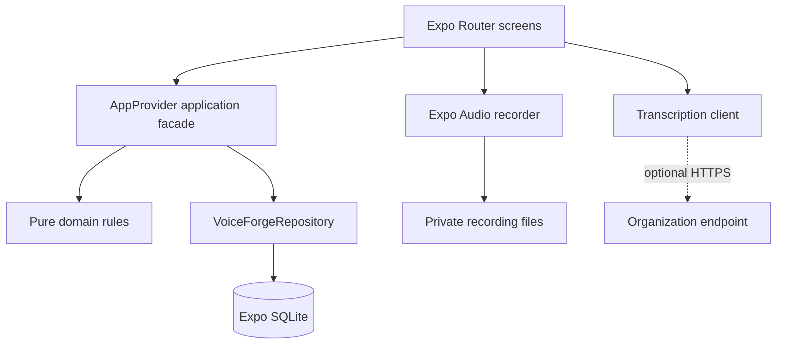

# VoiceForge Architecture

## System shape

VoiceForge is a local-first client. Expo Router composes screens; `AppProvider` exposes typed commands and hydrated state; `VoiceForgeRepository` owns persistence; SQLite is the authoritative structured-data store. Screens never issue SQL or create consequential records directly.

## Data ownership

- SQLite owns jobs, time entries, safety reports, voice logs, settings, and audit events.
- Application-private files own retained native audio.
- React state is a hydrated view of SQLite and is updated only after repository commands succeed.
- UI-only state owns form input, selected tabs, recorder presentation, and transient errors.

The initial demo records are seeded once using the `demo_seeded` setting. Clearing local data retains that marker so data does not unexpectedly reappear.

## Consequential command boundary

Clock-out creates a time entry and clears clock state in one transaction. Voice-derived time and safety commands reject missing explicit confirmation. Confirmed records store `sourceVoiceLogId`, and the transaction writes an audit event with the same provenance.

Edits and deletions append audit events. Job deletion uses restrictive foreign keys so a job referenced by time or safety records cannot be removed accidentally.

## Recording and transcription

Expo Audio owns the active recorder. The recorder reducer permits only valid lifecycle transitions. Completed native recordings are copied from temporary storage to `voice-recordings/`; discard and record deletion clean up files.

The transcription boundary accepts any compatible HTTPS endpoint. It applies a timeout and validates transcript/confidence/provider fields. Failures do not prevent manual review. No endpoint response can bypass the review screens.

## Future synchronization boundary

An authenticated sync service must add organization/user identities, authorization, stable server revisions, idempotency keys, tombstones, conflict resolution, encrypted transport, server audit retention, and supervisor approval. It must not reuse last-write-wins semantics for payroll or safety records without an explicit product and compliance decision.
